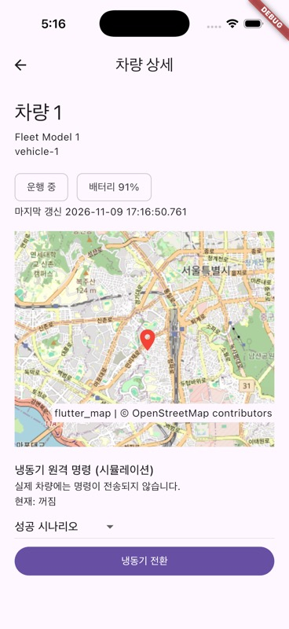

# FleetBridge

FleetBridge는 기존 UIKit 기반 차량관리 애플리케이션에 Flutter를 단계적으로 통합하는 Add-to-App 엔지니어링 포트폴리오입니다. 네이티브와 크로스플랫폼 간 상태 동기화, 생명주기 관리, 성능 측정 및 회귀 검증을 다룹니다. 차량과 냉동기 제어는 모두 모의 데이터이며 실제 차량·서버와 연결되지 않습니다.

## 마이그레이션 시리즈

FleetBridge는 네이티브 앱의 단계적 Flutter 전환 과정을 두 개의 독립 저장소로 보존한 기술 사례입니다.

- **Part 1 — [Native iOS + Flutter Add-to-App](https://github.com/CodingBot000/FleetBridge/releases/tag/v1.0-add-to-app)** (이 저장소): UIKit 기반 차량 목록과 Swift 데이터 저장소를 유지하면서 Flutter 상세 화면을 통합한 공존 구조
- **Part 2 — [Full Flutter Migration](https://github.com/CodingBot000/FleetBridge-Flutter/releases/tag/v1.0-full-flutter)** ([소스 저장소](https://github.com/CodingBot000/FleetBridge-Flutter)): 동일한 주요 기능을 Flutter/Dart로 이전하고 iOS·Android 공통 동작을 검증한 독립 앱

두 저장소는 별도의 Git 이력을 사용합니다. 두 번째 프로젝트의 [마이그레이션 비교 문서](https://github.com/CodingBot000/FleetBridge-Flutter/blob/v1.0-full-flutter/docs/migration.md)에 코드 역할과 기능 동등성·차이점을 기록했습니다.

## 주요 기능

- UIKit 차량 목록의 운행·대기·오프라인 상태와 배터리 표시
- Flutter 상세의 위치, 마지막 갱신, 모의 연결 상태 및 냉동기 명령 결과
- 중복 명령 방지, 성공·실패·시간 초과 시나리오, 중복·역순 이벤트 필터링
- OpenStreetMap 지도 출처 표시 및 오류 안내

## 실행 화면



[Simulator 데모 영상](docs/screenshots/fleetbridge-demo.mp4) · 지도 데이터 © [OpenStreetMap contributors](https://www.openstreetmap.org/copyright).

## 구조


Native `VehicleRepository`가 단일 원본이며 시뮬레이터가 데이터를 갱신합니다. 화면마다 `FlutterEngine`을 생성하고 닫힐 때 채널·알림 구독·엔진을 해제합니다. 따라서 초기 라우트와 Riverpod 상태가 다음 차량에 재사용되지 않습니다. 채널 준비 전 초기 요청은 제한적으로 재시도합니다.

## 실행 방법

macOS, Xcode 26.6, iOS Simulator, Flutter 3.47.9 Stable이 필요합니다. Flutter를 PATH에 추가하고 저장소 루트에서 실행합니다.

```sh
./scripts/bootstrap-ios.sh
open FleetBridgeHost/FleetBridgeHost.xcodeproj
```

`FleetBridgeHost` Scheme과 iOS Simulator를 선택해 실행합니다. 스크립트는 잠금 파일을 검증하고 로컬 Flutter Swift 패키지를 생성합니다. 생성물은 Git에 포함되지 않으며, 서명 없는 패키지는 Simulator 개발용입니다. 실기기 서명은 별도 설정이 필요합니다. Flutter 의존성 변경 후 스크립트를 다시 실행합니다.

## 검증

```sh
cd fleetbridge_detail
flutter pub get --enforce-lockfile
flutter analyze --no-pub
flutter test --no-pub
```

`main` 대상 PR은 Ubuntu GitHub Actions에서 Flutter 분석과 테스트를 수행합니다. iOS Simulator의 Native ↔ Flutter 통합은 로컬 Xcode에서 별도 검증합니다. [CI 성공 사례](https://github.com/CodingBot000/FleetBridge/actions/runs/42577934165)와 [의도적 실패 체크](https://github.com/CodingBot000/FleetBridge/actions/runs/42578131463)를 확인할 수 있습니다. 필수 체크 실패 시 보호된 `main` 병합이 차단되는 것을 검증했습니다.

## 기술적 결정과 한계

- 차량 ID, 이벤트 순서와 명령 상태는 Native 저장소가 관리하고 Flutter는 MethodChannel로 조회합니다. 데이터 및 명령은 실제 네트워크가 아닌 시뮬레이션입니다.
- 중복·역순 revision을 무시하고 차량별 중복 명령을 차단합니다. 화면 종료 후 늦은 응답은 파괴된 엔진에 전달하지 않습니다.
- OpenStreetMap 공용 타일의 가용성은 보장되지 않습니다. 화면에 출처를 표시하며 캐시는 HTTP 헤더를 따릅니다. 자동 UI 테스트는 타일을 요청하지 않습니다.
- 오프라인과 지연은 모의 차량 상태로, 단말의 실제 네트워크 감지가 아닙니다. 실기기 및 실제 iOS 18.0 환경은 검증하지 않았습니다.

## 성능 측정

Apple M4 Max / iOS 26.5 Simulator의 Debug 빌드에서 Native 상세 진입부터 Flutter 첫 렌더 콜백까지 30회 측정한 중앙값은 **550.731ms**, p95는 **650.091ms**였습니다. 지도 네트워크 요청은 제외했습니다. 측정은 Phase 2 기준이며 실기기 성능이 아닙니다. [측정 조건과 원시 데이터](docs/performance/first-frame.md)를 확인할 수 있습니다.

현재 화면마다 엔진을 생성하는 방식은 상태 격리와 명확한 해제 책임 때문에 유지합니다. 엔진 재사용 방식과의 동등 조건 비교, Instruments 메모리 프로파일링과 실기기 측정은 아직 수행하지 않았습니다.
