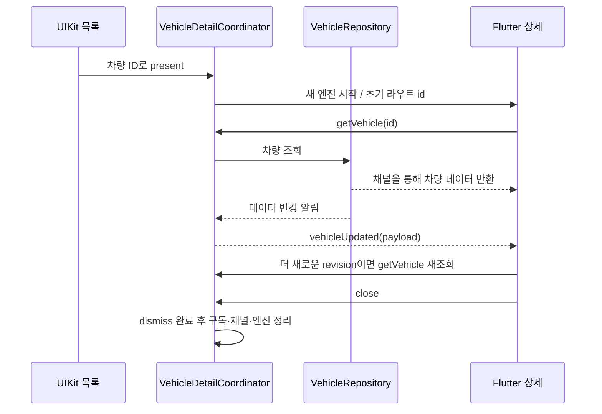

# Add-to-App 설계와 통신 계약

기준: `v1.0-add-to-app`의 구현. 이 문서는 현재 동작을 설명하며 새로운 기능이나 운영 정책을 정의하지 않습니다. 단계별 범위는 [Phase 1](specs/phase1.md)과 [Phase 2](specs/phase2.md)의 역사적 기록을 참고하세요.

## 책임과 데이터 흐름

| 구성요소 | 책임 |
|---|---|
| [VehicleRepository](../FleetBridgeHost/FleetBridgeHost/Vehicle.swift) | 차량 데이터의 단일 원본, 모의 갱신, 차량별 명령 중복 방지 |
| [ViewController](../FleetBridgeHost/FleetBridgeHost/ViewController.swift) | UIKit 목록과 선택, 앱 백그라운드·복귀에 따른 Native 타이머 관리 |
| [VehicleDetailCoordinator](../FleetBridgeHost/FleetBridgeHost/VehicleDetailCoordinator.swift) | 엔진·채널·알림 구독 생성과 해제, 조회·명령 중계, 화면 닫기 |
| [Flutter 상세 및 VehicleRevisionGate](../fleetbridge_detail/lib/main.dart) | Riverpod 조회 상태, 이벤트 revision 검사, 지도·상태·명령 UI |

## 채널 계약

채널 이름은 `fleetbridge/vehicle`입니다. 아래 이름과 결과는 코드에 정의된 값입니다.

| 방향 / 메시지 | 입력 | 결과 또는 처리 |
|---|---|---|
| Flutter → Native `getVehicle` | `id` | 차량 payload; 누락·잘못된 ID는 `not_found` |
| Native → Flutter `vehicleUpdated` | 차량 payload | 선택한 ID의 더 높은 정수 `revision`만 수락하고 원본 재조회 |
| Flutter → Native `setRefrigeration` | `id`, `enabled`, `scenario` | `success`, `failure`, `timeout`, `busy`; 입력 형식·선택 ID·시나리오가 잘못되면 `invalid_command` |
| Flutter → Native `close` | 없음 | 화면 닫기; 중복 닫기는 추가 실행하지 않음 |
| Flutter → Native `openMapAttribution` | 없음 | 고정된 OpenStreetMap 저작권 URL을 열고 성공 여부 반환 |
| Flutter → Native `reportFirstFrame` | 없음 | Debug 계측용 첫 렌더 시간 또는 아직 준비되지 않은 경우 null |

차량 payload는 `id`, `name`, `model`, `latitude`, `longitude`, `status`, `battery`, `updatedAt`, `refrigerationOn`, `revision`을 포함합니다. `updatedAt`은 epoch 밀리초이고, 상태 값은 `driving`·`idle`·`offline`입니다. 좌표·배터리·연결 상태는 모의 데이터입니다. 명령 시간 초과 역시 선택 가능한 시뮬레이션 결과이며 실제 네트워크 시간 제한 구현을 뜻하지 않습니다.

## 문제별 선택과 한계

### 초기 요청이 채널 등록보다 빠를 때

엔진 실행 이후 채널 핸들러를 등록합니다. Flutter의 `fetchVehicle`은 핸들러가 없는 `MissingPluginException`만 100ms 간격으로 최대 20번 시도합니다. 다른 오류는 자동 재시도하지 않습니다. Riverpod 기본 재시도로 오류 화면이 로딩 상태에 머무는 것을 막기 위해 provider의 자동 재시도도 끕니다. 사용자는 오류 화면에서 재시도할 수 있습니다.

명시적인 준비 완료 handshake를 추가하는 대안도 있지만 현재 구현은 제한된 초기 재시도를 사용합니다. 채널 준비 지연이 이 범위를 넘으면 오류가 표시되며 무한 대기는 하지 않습니다. 이 숫자는 현재 구현값이며 운영 서비스의 SLA가 아닙니다.

### 화면 종료 후 명령 응답이 도착할 때

명령 완료 시 coordinator와 엔진의 약한 참조 및 현재 엔진의 동일성을 확인합니다. 이전 엔진이 종료됐으면 응답을 보내지 않습니다. 이는 Native 명령 자체의 취소와 다릅니다. 모의 명령은 저장소에서 완료될 수 있으며, 닫힌 화면으로의 전달만 억제합니다.

### 이벤트가 중복·역순으로 도착할 때

`VehicleRevisionGate`는 선택한 ID와 마지막 수락 revision을 검사합니다. 더 최신인 알림만 원본 재조회를 유도합니다. 이 검사는 네트워크 메시지 복구나 누락 이벤트 재전송을 구현한 것은 아닙니다. 앱 복귀 시에는 원본을 다시 조회합니다.

### 엔진을 매번 생성하는 이유

화면마다 별도 isolate와 Riverpod 컨테이너를 만들어 다른 차량의 초기 라우트와 화면 상태가 섞이지 않게 합니다. `close` 후 dismiss 완료 시 알림 구독과 핸들러를 제거하고 `destroyContext()`를 호출합니다. 생성 비용을 줄일 수 있는 엔진 재사용은 비교 측정하지 않았으므로 성능상 우열을 주장하지 않습니다. [성능 측정의 범위](performance/first-frame.md)를 참고하세요.

### 지도와 앱 생명주기

Native 갱신 타이머와 Flutter 화면의 freshness 타이머는 백그라운드에서 중지하고 복귀 시 재개합니다. 지도 타일 제공자는 화면 갱신 때마다 다시 만들지 않으며 TileLayer가 해제를 담당합니다. 공용 타일은 고유 User-Agent와 출처 링크를 제공하고 라이브러리의 HTTP 캐시를 사용합니다. 자동 UI 테스트에서는 타일 레이어를 만들지 않고, 지도 실패 위젯 테스트는 가짜 이미지로 오류를 유발합니다.

각 결정의 회귀 테스트와 확인하지 않은 부분은 [검증 결과](verification.md)에 연결했습니다.
